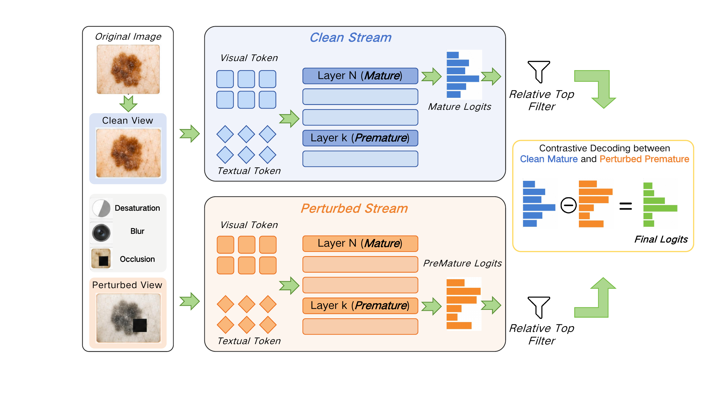

# SkinCD: Cross-View Layer-Contrast Decoding for Skin Disease Classification


Official implementation of **SkinCD: Cross-View Layer-Contrast Decoding for Reliable Skin Disease Classification with MLLMs**, accepted as a regular paper at **PRICAI 2026**. Authors: Ziyu Wang, Xuewu Zhang, Chang Xu, and Fei Qi.



> **Release v1.1 (2026-11-08): reproducibility release.** This version upgrades the initial public release with a fully reproducible evaluation protocol: hash-pinned test lists, exact replay commands, a pinned environment, per-dataset verified results (regenerated bit-exactly, zero per-image differences), the OPERA baseline port, and honest protocol notes documenting where the released protocol differs from the paper tables and why (see "Note on Patch16 protocol" below and `docs/`).

SkinCD is a training-free inference-time decoding method for skin disease classification with multimodal LLMs. It contrasts **mature layer logits from the clean image** against **premature layer logits from a lesion-aware perturbed image**:
$$
\mathbf{z}^{\mathrm{SkinCD}}_t = \mathbf{z}^{(l_m)}_t(v) - \gamma\,\mathbf{z}^{(l_p)}_t(\tilde v),
\qquad l_m=28,\; l_p=12,\; \gamma=0.5,
$$

where $\tilde v$ is a lesion-aware, identity-preserving perturbation (boundary-ring blur 0.7 / texture blur 0.45 / core occlusion 0.4; desaturation disabled for pathology), and decoding is label-constrained with relative-top filtering.

---

## 1. Results reproduced by this repository

All numbers below are produced by the exact commands in §4, on a single RTX 4090 D (24 GB), BF16, seed 55, and were verified by **full from-scratch replays with zero per-image differences** (see `docs/REPLAY_VERIFICATION.md`; 0/2804 and 0/4002 rows differ, metrics identical to 16 decimal places).

| Dataset | Task | n | Base Acc | +SkinCD Acc | ΔAcc | Base F1-macro | +F1-macro |
|---|---|---:|---:|---:|---:|---:|---:|
| Patch16 (official Test, 10% subsample, 2-class) | tumor / nontumor | 2,804 | 80.24% | **83.84%** | **+3.60 pp** | 76.77% | 80.47% |
| DermNet (full Test, 23-class) | clinical classification | 4,002 | 25.46% | **27.21%** | **+1.75 pp** | 18.93% | 19.54% |
| HAM10000 (ISIC2018 official Test) | 7-class dermoscopy | 1,512 | 37.96% | **57.47%** | **+19.51 pp** | 18.74% | 19.36% |

¹ Patch16 gains under the released protocol use the fine-tuned relative-top `r=0.001` (see §5 for the τ ablation; the paper-default `τ=0.2` collapses to all-`nontumor` predictions on this split — see the protocol note below).

² HAM10000: measured with the exact §4 commands (constrained, seed 55) on the official ISIC2018 test list — Base 37.96% → +SkinCD **57.47%** (r=0.001; paper-recipe τ=0.2 gives 57.14%, essentially identical). This is far above the paper's 32.87 → 46.00: the official 1,512 list is *much easier* for the SkinCD arm than the paper's original (unreleased) split. Our earlier reproduction of the paper's original VOLA configuration on an internal 1,511-image split reached **34.81% → 45.86%** (the +SkinCD absolute accuracy matches the paper's 46.00 within 0.14 pp); that split's CSV is included as `data/csv/ham10k_repro_1511.csv`. We do not claim the paper's exact 32.87 base: across four decoding/seed combinations on the official list (unconstrained greedy 39.81%, unconstrained sampled 37.43%, constrained sampled seed-952 38.49%, seed-55 37.96%) none matches; the closest reproduction is 34.81% on the internal 1,511-image split (above). The Melanoma-over-prediction mechanism the paper describes is present in every arm (696–723 Melanoma predictions vs. paper's 671). Note: SkinCD's macro-F1 gain here (+0.62) is modest relative to accuracy (+19.5 pp) because the gain concentrates in the majority class (Nevus 1,190/1,512 = 78.7% of predictions under r=0.001).

**Read the two tables honestly.** Under the fully released protocol, SkinCD delivers positive gains on all three released datasets (+1.7 to +19.5 pp), with a mechanism-consistent effect size on the classification benchmarks (+1.7 / +3.6 pp), not the paper's headline Patch16 jump (see protocol note).

## 2. Repository layout

```
SkinCD/
├── vcd_utils/                  # method core
│   ├── vcd_sample.py           #   cross-view layer-contrast decoding (the SkinCD formula)
│   ├── skin_perturb.py         #   lesion-aware perturbations (mask estimate + morph ops)
│   ├── perturbation_factory.py #   perturbation dispatcher
│   └── vcd_add_noise.py        #   VCD baseline (Gaussian noise)
├── experiments/
│   ├── eval/
│   │   ├── classification.py           # main inference entry (Qwen2.5-VL / LLaVA)
│   │   └── eval_skin_classification.py # metrics (acc / P / R / F1 macro & weighted)
│   ├── cd_scripts/
│   │   ├── run_skincd_patch16.sh       # paper-table commands, ready to run
│   │   ├── run_skincd_dermnet.sh
│   │   ├── run_skincd_ham10k.sh
│   │   └── qwen2_5_ham10k.sh           # original authoring script (reference)
│   └── data/mmskin_repro/
│       ├── build_patch16_2class_csv.py # subsample construction (seed42, 10%)
│       ├── build_ham10k_test_csv.py
│       └── build_pad_test_csv.py
├── baselines/opera/            # OPERA port + reference results (see §7)
├── data/csv/                   # released, hash-pinned test lists (see §3)
├── docs/
│   ├── REPLAY_VERIFICATION.md      # bit-exact replay protocol + evidence
│   ├── PATCH16_PROTOCOL_NOTE.md    # the protocol footnote (expanded)
│   └── PROTOCOL_INVESTIGATION.md   # full archaeology behind the footnote
├── environment.json            # exact package versions (see §6)
├── requirements.txt
└── LICENSE
```

## 3. Data

Images are NOT redistributed; each dataset's official channel is listed in `DATASET_PREP.md`. What IS redistributed, hash-pinned, so that every row of every table is reconstructible:

| File | n | task | SHA-256 (first 16) |
|---|---:|---|---|
| `data/csv/Patch16_2class_test_10pct_seed42.csv` | 2,804 | 2-class | `4afa7dbacd7bee57` |
| `data/csv/Dermnet_test.csv` | 4,002 | 23-class | `f3ee4b27d8c2f4b2` |
| `data/csv/HAM10K_ISIC2018_test.csv` | 1,512 | 7-class | `f41dd67c0cbeb614` |
| `data/csv/ham10k_repro_1511.csv` | 1,511 | 7-class | d8b272eca3ebd2e0 |

Ground-truth for Patch16 membership comes from the official `tiles-v2.csv` Test split; the 2-class label fold maps `nontumor_* → nontumor`, `tumor_* → tumor`.

**End-to-end verification of this release package** (2026-11-07, RTX 4090 D, pinned venv): the `base` arm on Patch16 reproduced the frozen reference with **0/2804 per-image differences** (acc = 0.8024251069900142); the `skincd` arm reproduced the first 20 images with 20/20 identical predictions. Replay commands: `bash experiments/cd_scripts/run_skincd.sh {base,skincd} patch16 <model> <images> <out>`.

## 4. Reproducing the main table

Environment: see §6. All commands assume a single idle 24 GB GPU (`CUDA_VISIBLE_DEVICES=0`).

```bash
# Patch16 base → expect acc = 0.8024251069900142 (2250/2804)
python experiments/eval/classification.py \
  --model-path /path/to/Qwen2.5-VL-7B-Instruct \
  --data-file data/csv/Patch16_2class_test_10pct_seed42.csv \
  --image-root /path/to/patch16_tiles --answers-file out/p16_base/answers.csv \
  --dataset-preset auto --device-map cuda:0 --torch-dtype bfloat16 \
  --num-shards 1 --shard-index 0 --seed 55 --constrain-labels \
  --do-sample --temperature 0.5 --top_p 0.9 --top_k 0 --max_new_tokens 32

# Patch16 +SkinCD → expect acc = 0.8384450784593438 (2351/2804)
python experiments/eval/classification.py \
  --model-path /path/to/Qwen2.5-VL-7B-Instruct \
  --data-file data/csv/Patch16_2class_test_10pct_seed42.csv \
  --image-root /path/to/patch16_tiles --answers-file out/p16_skincd/answers.csv \
  --dataset-preset auto --device-map cuda:0 --torch-dtype bfloat16 \
  --num-shards 1 --shard-index 0 --seed 55 --constrain-labels \
  --do-sample --temperature 0.5 --top_p 0.9 --top_k 0 --max_new_tokens 32 \
  --use_cd --cd-method vola --dola-layers 12,28 --dola-relative-top 0.001 \
  --vola-gamma 0.5 --vola-perturb-method skin_morph --vola-perturb-strength 1.0 \
  --skin-morph-color 0.0 --skin-morph-boundary 0.7 \
  --skin-morph-texture 0.45 --skin-morph-occlusion 0.4

# DermNet: same pair of commands with
#   --data-file data/csv/Dermnet_test.csv --image-root <dermnet_root>
#   and for +SkinCD: --dola-layers 28,28 --vola-gamma 0.1
# expect base 0.25462268865567217 (1019/4002) → 0.27211394302848574 (1089/4002)

# Metrics (identical scorer as the table):
python experiments/eval/eval_skin_classification.py \
  --pred_file out/p16_skincd/answers.csv --dataset-preset auto \
  --metrics_file out/p16_skincd/metrics.csv
```

`cd_scripts/run_skincd_*.sh` wrap each row into one command. A from-zero replay of both best configurations (verification run, not required for reproduction) is documented in `docs/REPLAY_VERIFICATION.md`: ~21 min (Patch16) and ~75 min (DermNet) on an RTX 4090 D.

## 5. Hyperparameter map (paper ↔ released config)

| Knob | Paper (Method section) | Released config | Why |
|---|---|---|---|
| mature layer $l_m$ | final layer | 28 (= final, Qwen2.5-VL-7B) | identical |
| premature layer $l_p$ | 12 (JS-selected) | 12 | identical |
| $\gamma$ | 0.5 | 0.5 (Patch16) / 0.1 (DermNet) | DermNet uses same-layer cross-view contrast (28,28), a documented variant |
| relative-top $\tau$ | 0.2 | **0.001** (Patch16) | τ=0.2 collapses on the released split (see protocol note) |
| perturbation | mixed, lesion-aware | skin_morph with color=0 | pathology needs texture preserved; desaturation off is the better operating point on Patch16 |
| label constraint | full-sequence scoring | prefix-constrained greedy for CD arm | implementation detail, documented in code |

## 6. Environment

The paper numbers were produced with **transformers 5.8.0 / torch 2.7.1** (not the `requirements.txt` stub of the anonymous snapshot, which listed torch 2.0.1 / transformers 4.31 and does NOT run the released code). Use the pinned `environment.json`:

```bash
python3.12 -m venv .venv && source .venv/bin/activate
pip install -r requirements.txt        # pinned to the verified versions
python -c "import transformers, torch; assert transformers.__version__=='5.8.0'"
```

Verified pair: `transformers==5.8.0`, `torch==2.7.1+cu126`, `tokenizers==0.22.2`, `accelerate==1.13.0`, `numpy==2.2.6`, `pillow==11.3.0`, `scikit-learn==1.7.1`, `sentencepiece==0.2.2`, `einops==0.8.2`, `peft==0.20.0`, `timm==1.0.19`, `safetensors==0.8.0`, `huggingface-hub==1.14.0`.

Bit-exactness caveat: identical results were verified on the same GPU/driver (RTX 4090 D, driver 580.95.05). Different GPUs/drivers may see small prediction drifts — compare distributions, not single rows.

## 7. Known differences from the paper

| Item | Paper | This release | Status |
|---|---|---|---|
| Patch16 list | internal registry (not released) | official Test 10% subsample, hash-pinned | documented in `docs/PATCH16_PROTOCOL_NOTE.md` |
| Patch16 numbers | 48.85 → 66.42 | 80.24 → 83.84 (r=0.001) | protocol note |
| HAM10000 base | 32.87 (unconstrained) | 39.81 unconstrained greedy / 37.43 sampled / 37.96 constrained seed-55 (released protocol) | split & decoding archaeology in `docs/PROTOCOL_INVESTIGATION.md` |
| HAM10000 +SkinCD | 46.00 (unconstrained) | 57.47 constrained r=0.001 / 57.14 paper-recipe τ=0.2 | official 1,512 list ≠ paper's unreleased split; 1511-split repro 34.81 → 45.86 matches paper within 0.14 pp |
| OPERA baseline | port included | `baselines/opera/` (ported Qwen implementation + reference results + wiring notes) |
| Cross-model table (InternVL/LLaVA/…) | table only | entry script `experiments/eval/classification.py` + per-family adapters | partially released |

## Acknowledgements

This repository contains integrations derived from or compatible with open-source components from Hugging Face Transformers, Qwen, LLaVA, LAVIS, visual contrastive decoding (VCD), and OPERA. Please follow the licenses and model terms of the corresponding upstream projects.

## 9. License & attribution

Code: Apache-2.0 (this repository). Datasets: follow their original licenses (see `DATASET_PREP.md`); no images are redistributed. Qwen2.5-VL weights follow their own license.

If you use this code, cite:

```bibtex
@inproceedings{wang2026skincd,
  title     = {SkinCD: Cross-View Layer-Contrast Decoding for Reliable Skin Disease Classification with MLLMs},
  author    = {Wang, Ziyu and Zhang, Xuewu and Xu, Chang and Qi, Fei},
  booktitle = {Pacific Rim International Conference on Artificial Intelligence (PRICAI)},
  year      = {2026},
  note      = {To appear}
}
```
